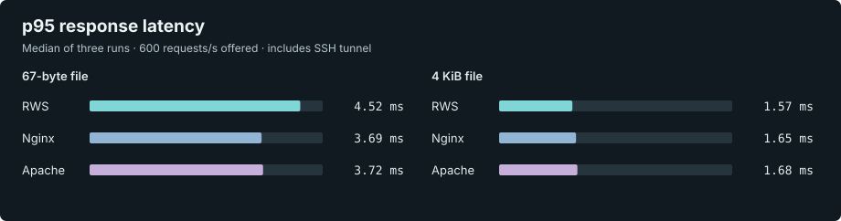
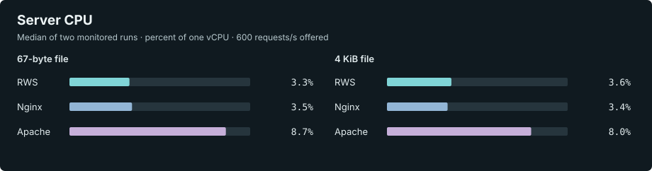

# Rust WebServer (RWS)

[](https://github.com/Cyber-Space-nl/RWS/actions/workflows/ci.yml)

RWS is an experimental event-driven Linux web server written in Rust. It serves static files and
PHP-FPM applications, provides a native WebSocket echo endpoint, and offers an optional HTTP
reverse proxy. It is an MVP for testing and measurement, not yet a drop-in replacement for Nginx
or Apache.

**One server build:** `rws` combines static files, PHP-FPM and WebSocket echo with optional
reverse proxying and adaptive WebSocket scheduling. Configure the features you need in one
configuration file; `rws-bench` and `rws-ws-load` are separate testing tools, not server variants.

The [v0.1.0-beta.2 prerelease](https://github.com/Cyber-Space-nl/RWS/releases/tag/v0.1.0-beta.2)
provides experimental Linux x86-64 binaries and release notes. It predates the current `rws`
binary, which is available from source and has not yet been published as a release.
Visit [rws.cyber-space.nl](https://rws.cyber-space.nl/) for the project overview and benchmark reports.

**Release versus source:** the `v0.1.0-beta.2` prerelease includes single byte ranges,
date-based conditional requests, optional gzip and optional Linux directory listings. The older
`v0.1.0-beta.1` binaries do not include these features. The `main` branch builds the current
`rws` binary from source.

## Local quickstart

On Linux with Rust 1.88 or newer, run the included loopback-only example without root privileges:

```bash
git clone https://github.com/Cyber-Space-nl/RWS.git
cd RWS
cargo run --locked -p rws -- --config config.dev.wsl.toml
```

In another terminal:

```bash
curl -i -H 'Host: localhost' http://127.0.0.1:18080/
curl -i http://127.0.0.1:19091/healthz
```

Stop the server with Ctrl+C. The example serves `examples/site`; it does not enable PHP or TLS.
For systemd installation, see [Ubuntu installation](UBUNTU_INSTALL.md).

### Try the static-file features

With the quickstart server running, request part of the example page:

```bash
curl -i -H 'Host: localhost' --range 0-15 http://127.0.0.1:18080/
```

The response should have status `206 Partial Content`, a `Content-Range` header and the first
16 bytes of the page. To check a conditional request, obtain its `Last-Modified` date and send it
back:

```bash
modified=$(curl -fsSI -H 'Host: localhost' http://127.0.0.1:18080/ | tr -d '\r' | sed -n 's/^[Ll]ast-[Mm]odified: //p')
curl -i -H 'Host: localhost' -H "If-Modified-Since: $modified" http://127.0.0.1:18080/
```

If the file has not changed, the second response should be `304 Not Modified`. When the static
cache is enabled, the response can reflect the cached file until its next revalidation.

Gzip and directory listings are **disabled by default**. To try either feature, enable it in the
existing static site's `[[sites]]` section of a local configuration file and restart RWS:

```toml
# Add only the features you want to enable inside [[sites]]:
gzip = true
directory_listing = true
```

After enabling gzip, `curl -i -H 'Host: localhost' --compressed http://127.0.0.1:18080/` should show
`Content-Encoding: gzip` for the example page. Directory listings are Linux-only and expose
visible filenames when a directory has no index file; enable them only where that is intended.
See [Configuration](#configuration) for the size limits and other details.

## Documentation and platforms

- [Architecture](docs/ARCHITECTURE.md), [security testing](docs/SECURITY_TESTING.md), [benchmarking](docs/BENCHMARKING.md) and [independent validation](docs/EXTERNAL_VALIDATION.md)
- [Contributing](CONTRIBUTING.md), [security policy](SECURITY.md) and [changelog](CHANGELOG.md)
- Linux is the deployment target; Ubuntu 24.04 on WSL2 and Linux GitHub Actions runners have been
  used for builds and tests. Linux 5.6 or newer is required for contained static-file opening.
  Windows workspace tests are useful for development but Windows deployment is not established.
- The workflow in this tree checks the locked workspace with Rust 1.88 and runs the main checks on stable Rust.
  A new dependency resolution may require a newer toolchain; use the committed lockfile.

## Benchmark snapshot

On 13 November 2026, an earlier RWS beta, Nginx and Apache served identical 67-byte and 4 KiB static
files on a shared two-vCPU Oracle ARM64 host. A separate generator offered 100 or 600 requests/s
over 50 HTTP/1.1 keep-alive connections through an SSH tunnel. Each scenario was repeated three
times for eight seconds; the servers were run in rotating order.





The p95 chart shows the median of **three run-level p95s**; the CPU chart shows the median of
**two monitored runs** per server and file. For the 4 KiB file at 600 offered requests/s, those
p95 values were 1.57 ms for RWS, 1.65 ms for Nginx and 1.68 ms for Apache. All 36 runs recorded
100,800 successful responses, with no recorded failed responses, connection failures or socket
errors. Nginx and Apache used tuned configurations; the servers have different cache designs.

The hosts also ran other services, and latency includes the network, SSH tunnel and client. These
short, capped tests do **not** establish maximum throughput or a general performance ranking. See
the [ARM64 results and methodology](docs/benchmark/arm64-2026-11-13.md),
[full ARM64 comparison](https://rws.cyber-space.nl/oracle-comparison-2026-11-13.html), and
[RWS-only ARM64 study](https://rws.cyber-space.nl/oracle-rws-2026-11-13.html).

The [historical x86 comparison](https://rws.cyber-space.nl/RWS_NGINX_APACHE_BENCHMARK.html) used a different 1-vCPU workload;
its 10,000 requests/s offered rate was a ceiling, not a maximum-throughput measurement. A separate
[20-million-request RWS memory stability test](https://rws.cyber-space.nl/RWS_MEMORY_STABILITY_20M.html) rose from 6.55 MiB
to 11.11 MiB RSS. It is not a cross-server memory comparison or proof that other workloads have no
memory leaks.

## Workspace components

- **`rws`** — the single web server, with static files, PHP-FPM, WebSocket echo and optional
  HTTP reverse proxy and adaptive scheduler tuning.
- **`rws-core`** — the shared library linked into `rws`; it is not a separate service.
- **`rws-ws-load`** — development tool that creates concurrent WebSocket connections and messages to measure behavior, performance and stability. It is not a production service.
- **`rws-bench`** — guarded native Linux HTTP/1.1 keep-alive scalability benchmark with
  resource checks, SSH monitoring, raw JSON and deterministic Markdown comparison reports.

## Implemented

- HTTP/1.1 on Tokio/Axum.
- Optional HTTPS using rustls and PEM certificate/key files.
- Strict Host-based virtual hosts; unknown hosts receive `421`.
- Static files with MIME detection, GET/HEAD, single byte ranges, date-based conditional requests
  and traversal protection; optional gzip and Linux directory listings.
- A configurable, process-wide static-file cache with bounded bytes and entries, LRU eviction,
  safe interval-based revalidation and Prometheus hit/miss/bypass/eviction metrics.
- A lock-sharded static hot path: fresh hits avoid filesystem access, path canonicalization and
  the slow-request semaphore. Only one request revalidates an expired entry.
- Streaming responses for files that are too large for the cache, without buffering the complete
  file in memory.
- PHP through PHP-FPM/FastCGI over a Unix socket or TCP.
- Native echo WebSocket endpoint.
- Ready-only Deficit Round Robin-style outbound scheduling.
- Bounded per-connection message/byte queues and slow-client isolation.
- Local health and Prometheus text metrics listener.
- Graceful SIGINT/SIGTERM shutdown.
- Strict TOML parsing; unknown configuration fields are rejected.
- Optional asynchronous access and error logs per virtual host.
- Configurable TCP listen backlog for HTTP connections.
- Sharded atomic request and cache counters to reduce contention on busy paths.
- Optional HTTP reverse proxy and bounded adaptive quantum controller.
- An Ubuntu installer and hardened systemd unit.
- A guarded WebSocket load tool.

## Explicit MVP limitations

- One TLS certificate/key pair per process; per-SNI certificates are not implemented yet.
- Static multi-range responses, entity-tag generation and strong validators are not implemented.
  If-Range requests receive a complete representation. The in-memory cache does not add
  browser/CDN cache-control headers.
- Site roots and their parent directories must not be writable by untrusted users. PHP-FPM opens
  scripts separately from RWS, and non-Linux builds do not have race-resistant contained opens.
- Linux static-file containment uses `openat2` (Linux 5.6 or newer); requests fail closed if it is unavailable.
- `request_timeout_ms` limits HTTP/1 header reading, proxy request-body reading and PHP requests;
  it is not a universal connection or response-stream timeout. HTTP/2 and slow-client limits still
  need additional validation.
- PHP routing supports direct `.php` script paths and an optional per-site front-controller fallback; PATH_INFO is not implemented.
- PHP-FPM response buffering is limited by `max_fastcgi_response_bytes` (default 8 MiB), which
  counts FastCGI framing, headers and stderr as well as the body. Oversized responses return 502.
- The HTTP proxy buffers request and response bodies up to `max_body_bytes` and `max_proxy_response_bytes`, respectively, and does not proxy WebSocket upgrades. The latter defaults to 8 MiB; oversized upstream responses return 502. These limits are per request, not global process memory limits.
- The proxy strips client-supplied `Forwarded`, `X-Forwarded-*` and `X-Real-IP` headers; it does not currently generate trusted forwarding headers. Backends must not rely on them for client identity.
- The scheduler currently governs native WebSocket outbound application messages; it does not replace Tokio or kernel scheduling.
- Metrics are counters/gauges only; latency histograms are still pending.
- The 2 MB idle RSS figure is an optimization goal, not a hard limit or acceptance criterion.

## Historical validation and deployment

The server build available at the time was deployed and validated on 27 October 2026 on the
project VPS:

- RWS was active on ports 80 and 443; Nginx was isolated on benchmark port 18081.
- The test site returned HTTP 200 and the benchmark file returned the expected 77-byte body.
- The static cache is enabled with a 64 MiB total limit, 1 MiB per-file limit, 4,096 entries and
  a 1,000 ms revalidation interval.
- HTTP and HTTPS use a listen backlog of 1,024.
- The production binary was built on the target host with native CPU tuning, fat LTO and one
  code-generation unit. Its SHA-256 is
  `8104bb0910485098a4990b085c5ee56003029e1305ed6d2603b4c34c13225508`.
- The final smoke check recorded 20 cache hits and one miss, with no bypasses, evictions,
  invalidations or service errors.
- This historical deployment predates the current `rws` binary.

These are historical observations, not a statement about the current server or a current release.
Check the CI badge for the latest automated status; [security testing](docs/SECURITY_TESTING.md)
describes the scope and limitations of local validation.

The latest externally measured optimized-cache result, taken after the first four hot-path
optimizations but before the final 5-10 deployment, was **57,927.69 requests/second** at four wrk
threads and 100 connections, with p50 1.70 ms and p99 2.31 ms. The comparable Nginx repeat was
41,588.59 requests/second, p50 2.33 ms and p99 4.02 ms. This is a measured result for that build,
not yet a performance claim for the final deployed binary.

## Ubuntu 24.04 system installation

For a more focused installation and operations guide, see `UBUNTU_INSTALL.md`.

Install build and PHP dependencies:

```bash
sudo apt update
sudo apt install -y build-essential curl pkg-config php8.3-fpm
curl --proto '=https' --tlsv1.2 -sSf https://sh.rustup.rs | sh
source "$HOME/.cargo/env"
rustup toolchain install stable
```

From the project directory:

```bash
chmod +x scripts/*.sh
cargo fmt --check
cargo test --workspace
./scripts/build-linux.sh
sudo ./scripts/install.sh
sudoedit /etc/rws/config.toml
sudo /usr/local/bin/rws --config /etc/rws/config.toml --check
sudo systemctl enable --now rws
```

`--check` validates TOML and loads configured TLS files; it does not prove that the service account
can access them, that PHP-FPM is reachable, or that listeners can bind. Check the service logs
after startup.

Test the default example vhost:

```bash
curl -i -H 'Host: example.test' http://127.0.0.1:8080/
curl -i http://127.0.0.1:9091/healthz
curl -s http://127.0.0.1:9091/metrics
sudo journalctl -u rws -f
```

To enable the PHP sample in an isolated test environment:

```bash
sudo install -m 0644 examples/site/info.php /var/www/example.test/public/info.php
curl -i -H 'Host: example.test' http://127.0.0.1:8080/info.php
```

The sample exposes PHP configuration through `phpinfo()`; remove it after testing and do not
expose it publicly.

If Ubuntu uses a different PHP-FPM socket, find it and update `php_fpm`:

```bash
find /run/php -maxdepth 1 -type s -name 'php*-fpm.sock' -print
```

## TLS

Place certificate files in the RWS `tls` directory, enable the `[tls]` section and restart:

```toml
[tls]
cert_file = "/etc/rws/tls/fullchain.pem"
key_file = "/etc/rws/tls/privkey.pem"
```

```bash
sudo /usr/local/bin/rws --config /etc/rws/config.toml --check
sudo systemctl restart rws
```

RWS does not issue certificates in this MVP. Use an external ACME client and ensure the `rws` service account can read the deployed key through an appropriately restricted group or copied file.

## Configuration

Start with:

- `config.example.toml`

Static sites support a single byte range for GET and `Last-Modified` / `If-Modified-Since`
conditional requests. Multiple ranges and `If-Range` are ignored and receive the full response;
HEAD ignores Range. Date validators follow the existing cache revalidation interval, so a cached
file can remain visible until revalidated. No ETag is currently generated.

The following per-site options are **off by default**:

```toml
[[sites]]
host = "files.example.test"
root = "/var/www/files.example.test/public"
gzip = true
directory_listing = true
```

Gzip applies to eligible text, JSON, JavaScript, XML and SVG static files up to 1 MiB when the
client accepts it; files must also fit the configured static-cache file and total size limits,
even when the cache is disabled. Gzip is not applied to PHP or proxy responses. Byte-range
requests prefer the identity representation. Compression is bounded to at most 16 concurrent jobs. Directory
listings are Linux-only, use a contained opened directory, omit hidden entries and symlinks, and
are capped at 1,024 entries, 4,096 examined entries and 256 KiB of names. Enable them only for directories whose visible
contents may be published. Listings require `/proc/self/fd` to be available. An existing index
file takes precedence over listing. On non-Linux builds directory listings are unavailable.

Static files can be held in a process-wide, bounded LRU cache. It is disabled when the section
is omitted, which keeps old configurations compatible and provides a clean benchmark baseline.
The byte limits cover cached response bodies; `max_entries` also bounds per-entry bookkeeping.
PHP scripts, front-controller responses and proxy responses never enter this cache.

```toml
[static_cache]
enabled = true
max_total_bytes = 67108864
max_file_bytes = 1048576
max_entries = 4096
revalidate_after_ms = 1000
```

Fresh cache hits do not access the filesystem. After `revalidate_after_ms`, one request validates
the file while concurrent requests can continue using the cached response. Filesystem delays or
errors can affect when a change becomes visible. Set the value to `0` to validate on every request.

The cache is split into up to 16 independently locked shards. A fresh hit returns the cached body,
content type and content length directly. Cache misses, filesystem work, PHP and proxy requests
use the bounded slow-request semaphore; cached static hits do not consume those permits. Files
larger than `max_file_bytes` are streamed asynchronously and counted as cache bypasses.

The server listen queue is independently configurable:

```toml
[server]
listen_backlog = 1024
```

Set `enabled = false` for uncached comparison runs. Cache behavior is exported as
`rws_static_cache_hits_total`, `rws_static_cache_misses_total`,
`rws_static_cache_bypasses_total`, `rws_static_cache_evictions_total`,
`rws_static_cache_invalidations_total`, `rws_static_cache_revalidations_total`,
`rws_static_cache_entries` and
`rws_static_cache_bytes` on the metrics listener.

PHP endpoints use one of these forms:

```toml
php_fpm = "unix:/run/php/php8.3-fpm.sock"
# Optional fallback for application routes such as /login:
front_controller = "index.php"
access_log = "/var/log/rws/example.test.access.log"
error_log = "/var/log/rws/example.test.error.log"
# or
php_fpm = "tcp:127.0.0.1:9000"
```

Site logs use bounded asynchronous queues. Access entries contain the client, host, method, URI,
HTTP version, status, response length when known and request duration. Error logs contain all
4xx/5xx requests plus available internal PHP, static-file and proxy errors. The Ubuntu units
create the writable log directory and the installer configures daily rotation.

Optional proxy site:

```toml
[[sites]]
host = "app.example.test"
mode = "proxy"
upstream = "http://127.0.0.1:3000"
```

## WebSocket test

Add `example.test` to DNS or `/etc/hosts`, then:

```bash
cargo run -p rws-ws-load -- \
  --url ws://example.test:8080/_rws/ws \
  --connections 1000 \
  --messages 10 \
  --payload-bytes 128 \
  --idle-seconds 5
```

Tests above 10,000 connections require the explicit `--allow-large-test` flag. Never start a 100k test without preparing file-descriptor, memory, port-range and load-generator capacity.

## Measure RWS

Build and run the installed configuration as a non-production test:

```bash
./scripts/build-linux.sh
./scripts/measure-linux.sh ./target/release/rws /etc/rws/config.toml
```

For a host-specific production binary, build on the target VPS with
`RWS_NATIVE_CPU=1 ./scripts/build-linux.sh`. Release builds use fat LTO. A native build may
not run on an older or different CPU, so keep the portable rollback binary.

Profile-guided optimization (PGO) is not enabled. It should only be added with a representative
training workload and a repeatable benchmark that demonstrates a real improvement.

The script prints binary bytes, idle RSS in KiB and thread count. Use `systemd-run --scope -p AllowedCPUs=0 ...` or `taskset -c 0` for repeatable one-core load tests.

For a quick local HTTP throughput and latency matrix, configure a static benchmark-only host
without access logs, install `wrk`, and run:

```bash
./scripts/benchmark-http.sh http://127.0.0.1/robots.txt bench.local
```

For reproducible cold and warm workloads, environment recording and JSON/Markdown reports, see
[the benchmarking guide](docs/BENCHMARKING.md).

Run the load generator on a separate machine for publishable results so it does not compete with
the server for CPU. Benchmark static HTTP, TLS, PHP and WebSockets separately.

## Upgrade and rollback

The installer backs up an existing binary, unit and logrotate file with a timestamp and preserves existing
configuration. Before upgrading, back up
configuration, logrotate settings and site data separately. To roll back, stop the service, restore
the matching binary and unit backups, reload systemd and restart:

```bash
sudo systemctl stop rws
sudo cp -a /usr/local/bin/rws.backup.TIMESTAMP /usr/local/bin/rws
sudo cp -a /etc/systemd/system/rws.service.backup.TIMESTAMP /etc/systemd/system/rws.service
sudo systemctl daemon-reload
sudo systemctl start rws
```

## Uninstall

```bash
sudo ./scripts/uninstall.sh
```

The uninstall script preserves `/etc/rws`, logs, `/var/www` data and older RWS installations.

## Developer checks

See [security testing and limitations](docs/SECURITY_TESTING.md) for the test scope and remaining trust boundaries.

```bash
cargo fmt --check
cargo check --workspace
cargo test --workspace
cargo clippy --workspace --all-targets -- -D warnings
cargo build --release -p rws
cargo tree -p rws -e features
```

The WebSocket and benchmark tools remain separate development tools, not alternate servers.

## License

RWS is available under the [MIT License](LICENSE).

