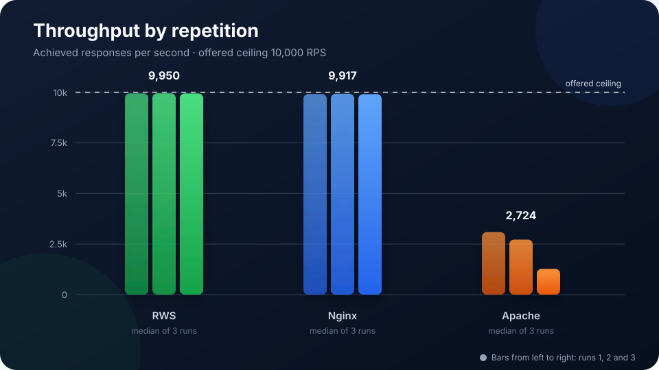
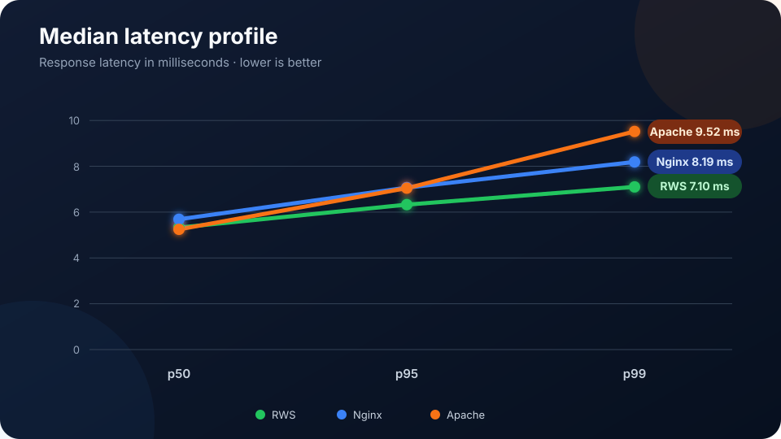
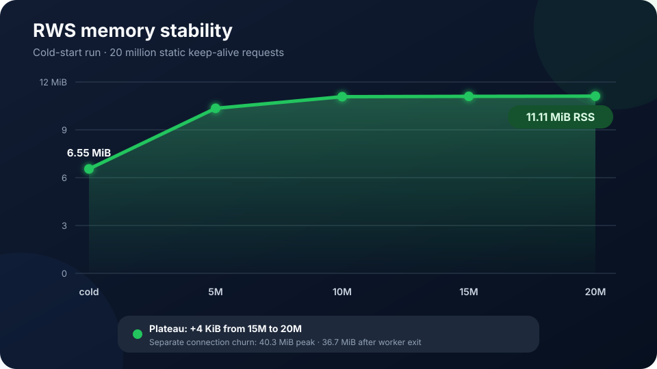
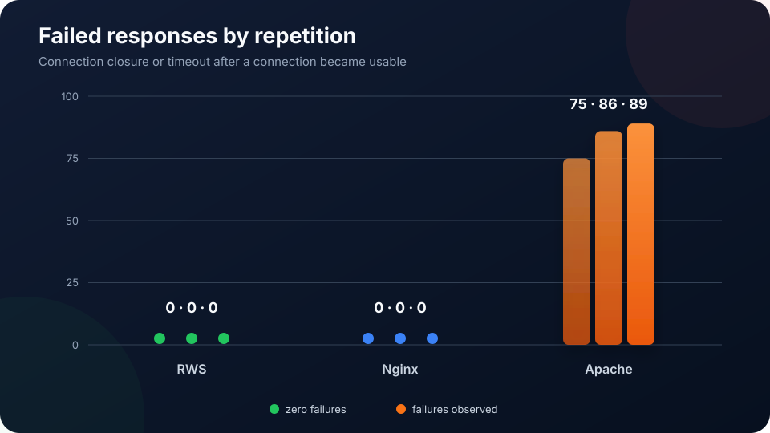

# Rust WebServer (RWS)

RWS is an experimental event-driven Linux webserver written in Rust. The workspace contains two server binaries, a shared core library and a WebSocket load-testing tool.

## Benchmark snapshot

RWS, Nginx and Apache were compared on the same 1-vCPU Ubuntu VPS using a byte-identical
77-byte static file. Each server received three 15-second runs with 1,000 keep-alive connections
and an offered rate of 10,000 requests/second. The results below were measured on 27 October 2026.

<table>
  <tr>
    <td width="50%"></td>
    <td width="50%"></td>
  </tr>
  <tr>
    <td width="50%"></td>
    <td width="50%"></td>
  </tr>
</table>

At this capped workload, RWS and Nginx both sustained more than 99% of the offered rate without
failed responses. RWS recorded a median p99 latency of **7.10 ms**, compared with **8.19 ms** for
Nginx. Apache saturated below the offered rate and recorded 250 failed responses across its three
runs. RWS used substantially more resident memory: **254.7 MiB**, versus **11.9 MiB** for Nginx
and **95.1 MiB** for Apache.

These measurements describe this specific host and workload; the offered-rate ceiling means they
do not establish maximum RWS or Nginx throughput. See the
[full benchmark report](RWS_NGINX_APACHE_BENCHMARK.html) for the environment, individual runs,
resource data, warnings and interpretation.

## Workspace components

- **`rsw-core`** — shared library containing configuration, HTTP/WebSocket handling, scheduling, metrics and server lifecycle logic. It is linked into the server binaries and is not installed as a separate service.
- **`rsw-simple`** — the default lightweight server binary, with a strict configuration surface and minimal enabled functionality.
- **`rsw-comfy`** — the extended server binary, with reverse proxy support and optional adaptive scheduler tuning.
- **`rsw-ws-load`** — development tool that creates concurrent WebSocket connections and messages to measure behavior, performance and stability. It is not a production service.
- **`rws-bench`** — guarded native Linux HTTP/1.1 keep-alive scalability benchmark with
  resource checks, SSH monitoring, raw JSON and deterministic Markdown comparison reports.

This is an MVP for correctness testing and performance measurement. It is not yet a drop-in replacement for Nginx or Apache.

## Implemented

- HTTP/1.1 on Tokio/Axum.
- Optional HTTPS using rustls and PEM certificate/key files.
- Strict Host-based virtual hosts; unknown hosts receive `421`.
- Static files with MIME detection, GET/HEAD and traversal protection.
- A configurable, process-wide static-file cache with bounded bytes and entries, LRU eviction,
  safe interval-based revalidation and Prometheus hit/miss/bypass/eviction metrics.
- A lock-sharded static hot path: fresh hits avoid filesystem access, path canonicalization and
  the slow-request semaphore. Only one request revalidates an expired entry.
- Streaming responses for files that are too large for the cache, without buffering the complete
  file in memory.
- PHP through PHP-FPM/FastCGI over a Unix socket or TCP.
- Native echo WebSocket endpoint.
- Ready-only Deficit Round Robin-style outbound scheduling.
- Bounded per-connection message/byte queues and slow-client isolation.
- Local health and Prometheus text metrics listener.
- Graceful SIGINT/SIGTERM shutdown.
- Strict TOML parsing; unknown configuration fields are rejected.
- Optional asynchronous access and error logs per virtual host.
- Configurable TCP listen backlog and `TCP_NODELAY` for HTTP connections.
- Sharded atomic request and cache counters to reduce contention on busy paths.
- Comfy-only HTTP reverse proxy and bounded adaptive quantum controller.
- Separate Ubuntu installers and hardened systemd units.
- A guarded WebSocket load tool.

## Explicit MVP limitations

- One TLS certificate/key pair per process; per-SNI certificates are not implemented yet.
- Static range requests, conditional requests, response compression and directory listings are
  not implemented. The in-memory cache does not add browser/CDN cache-control headers.
- PHP routing supports direct `.php` script paths and an optional per-site front-controller fallback; PATH_INFO is not implemented.
- Comfy HTTP proxy buffers request and response bodies up to configured limits and does not proxy WebSocket upgrades.
- The scheduler currently governs native WebSocket outbound application messages; it does not replace Tokio or kernel scheduling.
- Metrics are counters/gauges only; latency histograms are still pending.
- The 2 MB idle RSS figure is an optimization goal, not a hard limit or acceptance criterion.

## Latest validated deployment

The optimized `rsw-simple` build was deployed and validated on 27 October 2026 on the project VPS:

- RWS is active on ports 80 and 443; Nginx remains isolated on benchmark port 18081.
- The production site returns HTTP 200 and the benchmark file returns the expected 77-byte body.
- The static cache is enabled with a 64 MiB total limit, 1 MiB per-file limit, 4,096 entries and
  a 1,000 ms revalidation interval.
- HTTP and HTTPS use a listen backlog of 1,024.
- The production binary was built on the target host with native CPU tuning, fat LTO and one
  code-generation unit. Its SHA-256 is
  `8104bb0910485098a4990b085c5ee56003029e1305ed6d2603b4c34c13225508`.
- The final smoke check recorded 20 cache hits and one miss, with no bypasses, evictions,
  invalidations or service errors.
- The last complete local and Linux validation passed all 29 workspace tests and Clippy with
  warnings treated as errors.

The latest externally measured optimized-cache result, taken after the first four hot-path
optimizations but before the final 5-10 deployment, was **57,927.69 requests/second** at four wrk
threads and 100 connections, with p50 1.70 ms and p99 2.31 ms. The comparable Nginx repeat was
41,588.59 requests/second, p50 2.33 ms and p99 4.02 ms. This is a measured result for that build,
not yet a performance claim for the final deployed binary.

## Ubuntu 24.04 quick start

For a more focused installation and operations guide, see `UBUNTU_INSTALL.md`.

Install build and PHP dependencies:

```bash
sudo apt update
sudo apt install -y build-essential curl pkg-config php8.3-fpm
curl --proto '=https' --tlsv1.2 -sSf https://sh.rustup.rs | sh
source "$HOME/.cargo/env"
rustup toolchain install stable
```

From the project directory:

```bash
chmod +x scripts/*.sh
cargo fmt --check
cargo test --workspace
./scripts/build-linux.sh simple
sudo ./scripts/install-simple.sh
sudoedit /etc/rsw-simple/config.toml
sudo /usr/local/bin/rsw-simple --config /etc/rsw-simple/config.toml --check
sudo systemctl enable --now rsw-simple
```

Test the default example vhost:

```bash
curl -i -H 'Host: example.test' http://127.0.0.1:8080/
curl -i http://127.0.0.1:9091/healthz
curl -s http://127.0.0.1:9091/metrics
sudo journalctl -u rsw-simple -f
```

To enable the PHP sample:

```bash
sudo install -m 0644 examples/site/info.php /var/www/example.test/public/info.php
curl -i -H 'Host: example.test' http://127.0.0.1:8080/info.php
```

If Ubuntu uses a different PHP-FPM socket, find it and update `php_fpm`:

```bash
find /run/php -maxdepth 1 -type s -name 'php*-fpm.sock' -print
```

## Comfy installation

`rsw-comfy` is installed independently. Stop Simple first if both configs use the same ports:

```bash
./scripts/build-linux.sh comfy
sudo ./scripts/install-comfy.sh
sudoedit /etc/rsw-comfy/config.toml
sudo /usr/local/bin/rsw-comfy --config /etc/rsw-comfy/config.toml --check
sudo systemctl disable --now rsw-simple 2>/dev/null || true
sudo systemctl enable --now rsw-comfy
```

## TLS

Place certificate files in the selected variant's `tls` directory, enable the `[tls]` section and restart:

```toml
[tls]
cert_file = "/etc/rsw-simple/tls/fullchain.pem"
key_file = "/etc/rsw-simple/tls/privkey.pem"
```

```bash
sudo /usr/local/bin/rsw-simple --config /etc/rsw-simple/config.toml --check
sudo systemctl restart rsw-simple
```

RWS does not issue certificates in this MVP. Use an external ACME client and ensure the `rsw` service account can read the deployed key through an appropriately restricted group or copied file.

## Configuration

Start with:

- `config.simple.example.toml`
- `config.comfy.example.toml`

Static files can be held in a process-wide, bounded LRU cache. It is disabled when the section
is omitted, which keeps old configurations compatible and provides a clean benchmark baseline.
The byte limits cover cached response bodies; `max_entries` also bounds per-entry bookkeeping.
PHP scripts, front-controller responses and proxy responses never enter this cache.

```toml
[static_cache]
enabled = true
max_total_bytes = 67108864
max_file_bytes = 1048576
max_entries = 4096
revalidate_after_ms = 1000
```

Fresh cache hits do not access the filesystem. After `revalidate_after_ms`, one request validates
the file while concurrent requests continue using the cached response. A changed or replaced file
is therefore visible after at most the configured interval plus one metadata operation. Set the
value to `0` for strict validation on every request.

The cache is split into 16 independently locked shards. A fresh hit returns the cached body,
content type and content length directly. Cache misses, filesystem work, PHP and proxy requests
use the bounded slow-request semaphore; cached static hits do not consume those permits. Files
larger than `max_file_bytes` are streamed asynchronously and counted as cache bypasses.

The server listen queue is independently configurable:

```toml
[server]
listen_backlog = 1024
```

Set `enabled = false` for uncached comparison runs. Cache behavior is exported as
`rsw_static_cache_hits_total`, `rsw_static_cache_misses_total`,
`rsw_static_cache_bypasses_total`, `rsw_static_cache_evictions_total`,
`rsw_static_cache_invalidations_total`, `rsw_static_cache_revalidations_total`,
`rsw_static_cache_entries` and
`rsw_static_cache_bytes` on the metrics listener.

PHP endpoints use one of these forms:

```toml
php_fpm = "unix:/run/php/php8.3-fpm.sock"
# Optional fallback for application routes such as /login:
front_controller = "index.php"
access_log = "/var/log/rsw-simple/example.test.access.log"
error_log = "/var/log/rsw-simple/example.test.error.log"
# or
php_fpm = "tcp:127.0.0.1:9000"
```

Site logs use bounded asynchronous queues. Access entries contain the client, host, method, URI,
HTTP version, status, response length when known and request duration. Error logs contain all
4xx/5xx requests plus available internal PHP, static-file and proxy errors. The Ubuntu units
create the writable log directory and the installer configures daily rotation.

Comfy proxy site:

```toml
[[sites]]
host = "app.example.test"
mode = "proxy"
upstream = "http://127.0.0.1:3000"
```

## WebSocket test

Add `example.test` to DNS or `/etc/hosts`, then:

```bash
cargo run -p rsw-ws-load -- \
  --url ws://example.test:8080/_rsw/ws \
  --connections 1000 \
  --messages 10 \
  --payload-bytes 128 \
  --idle-seconds 5
```

Tests above 10,000 connections require the explicit `--allow-large-test` flag. Never start a 100k test without preparing file-descriptor, memory, port-range and load-generator capacity.

## Measure Simple

Build and run the installed configuration as a non-production test:

```bash
./scripts/build-linux.sh simple
./scripts/measure-linux.sh ./target/release/rsw-simple /etc/rsw-simple/config.toml
```

For a host-specific production binary, build on the target VPS with
`RSW_NATIVE_CPU=1 ./scripts/build-linux.sh simple`. Release builds use fat LTO. A native build may
not run on an older or different CPU, so keep the portable rollback binary.

Profile-guided optimization (PGO) is not enabled. It should only be added with a representative
training workload and a repeatable benchmark that demonstrates a real improvement.

The script prints binary bytes, idle RSS in KiB and thread count. Use `systemd-run --scope -p AllowedCPUs=0 ...` or `taskset -c 0` for repeatable one-core load tests.

For a quick local HTTP throughput and latency matrix, configure a static benchmark-only host
without access logs, install `wrk`, and run:

```bash
./scripts/benchmark-http.sh http://127.0.0.1/robots.txt bench.local
```

The reproducible RWS/Nginx procedure, equivalence checks, cache toggles and deploy/rollback
commands are in `BENCHMARK_STATIC.md`.

Run the load generator on a separate machine for publishable results so it does not compete with
the server for CPU. Benchmark static HTTP, TLS, PHP and WebSockets separately.

## Upgrade and rollback

The installers back up an existing binary and unit with a timestamp. They preserve existing configuration. To roll back, stop the service, restore the selected `.backup.TIMESTAMP` files and restart.

```bash
sudo systemctl stop rsw-simple
sudo cp -a /usr/local/bin/rsw-simple.backup.TIMESTAMP /usr/local/bin/rsw-simple
sudo systemctl start rsw-simple
```

## Uninstall

```bash
sudo ./scripts/uninstall.sh simple
# or
sudo ./scripts/uninstall.sh comfy
```

The uninstall script preserves `/etc/rsw-*` and `/var/www` data.

## Developer checks

```bash
cargo fmt --check
cargo check --workspace
cargo test --workspace
cargo clippy --workspace --all-targets -- -D warnings
cargo build --release -p rsw-simple
cargo build --release -p rsw-comfy
cargo tree -p rsw-simple -e features
cargo tree -p rsw-comfy -e features
```

Build each release package separately when comparing dependencies and binary sizes so Cargo feature unification cannot distort the comparison.

## License

RWS is available under the [MIT License](LICENSE).

