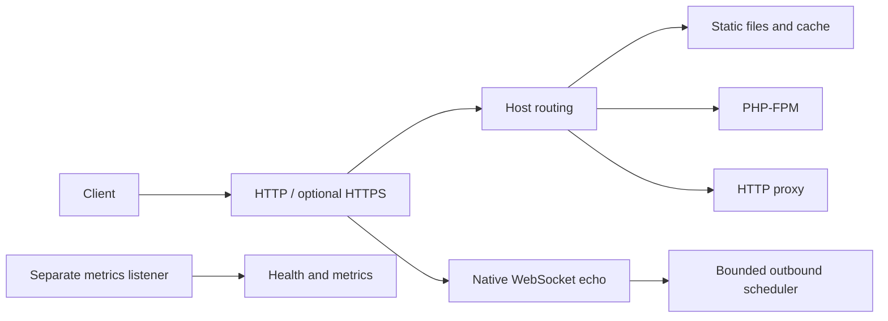

# RWS architecture

## Workspace and request flow

`rws` is the single server binary around `rws-core`. HTTP reverse proxying and adaptive WebSocket
scheduler controls are available in the same build and enabled through configuration.
The workspace also includes `rws-ws-load` and `rws-bench`, which are test tools, not services.

At startup, RWS parses strict TOML configuration, validates sites and configured TLS files, builds
the site map, cache and scheduler, and starts HTTP, optional HTTPS and a separate metrics listener.
The public router accepts the configured native WebSocket path and dispatches other requests by
normalized Host. An unknown host receives 421. Static sites resolve a file beneath their root,
optionally dispatch `.php` requests or missing routes to PHP-FPM, and serve other files for GET or
HEAD. Proxy sites send HTTP requests to their configured upstream.

## Storage, concurrency and limits

The optional process-wide static cache is split into up to 16 shards, each with its own limits and
lock. Fresh hits reuse body and headers without filesystem access; expired entries are checked by
one request while others may receive the previous value. Cache misses and PHP/proxy work use a
bounded slow-request semaphore; fresh static hits bypass it. Large static files stream rather than
enter the cache. On Linux, contained static opens use `openat2` and the opened descriptor is retained
for reading. Root and parent trust remains necessary, especially for PHP-FPM, which opens scripts
separately. See [security testing](SECURITY_TESTING.md) for trust boundaries and non-Linux limits.

WebSocket sessions register with a shared ready-queue scheduler. Per-connection outbound queues
and writer channels are bounded; a slow or disconnected peer can be rejected or disconnected.
The optional controller adjusts scheduler quantum within configured limits. This scheduler does
not schedule ordinary HTTP traffic or replace Tokio and kernel scheduling.

PHP requests and proxy bodies are buffered with configurable per-request bounds. FastCGI response
limits count protocol framing, headers and stderr as well as body bytes. The proxy filters
hop-by-hop and untrusted forwarding headers and does not support WebSocket proxying. These limits
do not impose a global memory budget. `request_timeout_ms` covers HTTP/1 header reading, proxy and
PHP request bodies, PHP operations and the configured proxy-client timeout; it is not a universal
deadline for all connections or streaming responses.

## Lifecycle and operations

The metrics listener exposes `/healthz` and `/metrics`; its default address is loopback, and it is
separate from public host routing. Optional site logs use bounded asynchronous queues. SIGINT and
SIGTERM trigger graceful shutdown within the configured period. Systemd units and installers are
provided for Ubuntu; the installers preserve existing configuration and create timestamped backups
of an existing binary and unit. See [installation](../UBUNTU_INSTALL.md) for operational details
and [benchmarking](BENCHMARKING.md) for measurement methodology.
